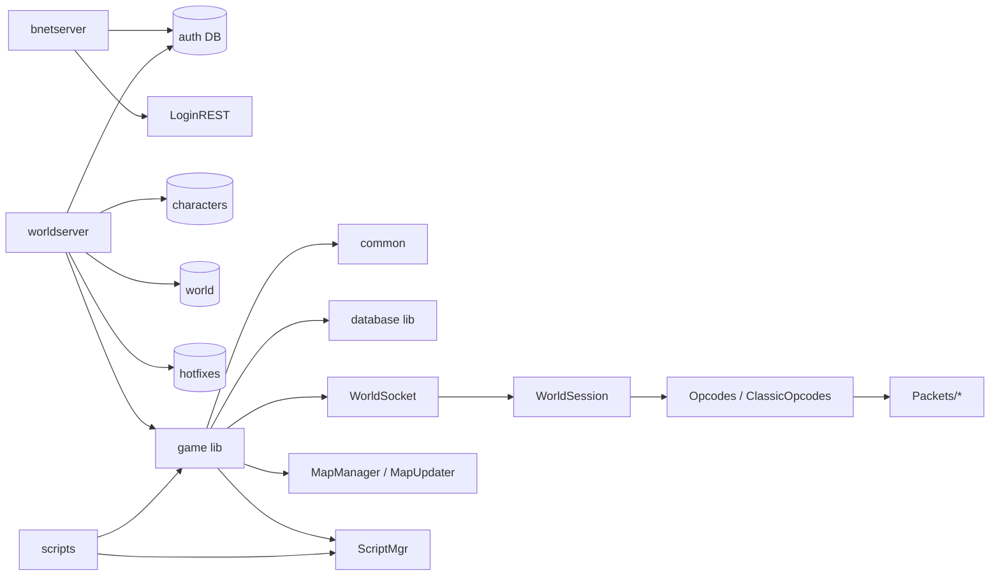
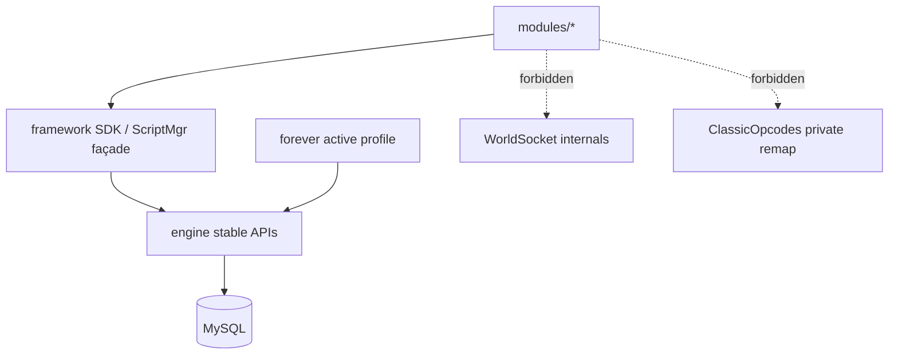

# Component Dependency Map (M1)

**Status:** Proposed (describes current + target edges)  
**Italian:** [`../it/COMPONENT_DEPENDENCY_MAP.md`](../it/COMPONENT_DEPENDENCY_MAP.md)

## Current major edges (evidence)

### Key source files

| Component | Paths |
|---|---|
| bnetserver | `src/server/bnetserver/Main.cpp`, `REST/LoginRESTService.cpp`, `Services/AuthenticationService.cpp` |
| worldserver | `src/server/worldserver/Main.cpp` |
| World loop | `src/server/game/World/World.cpp` |
| Sockets | `src/server/game/Server/WorldSocket.cpp`, `WorldSocketMgr.cpp` |
| Session / opcodes | `WorldSession.*`, `Protocol/Opcodes.*`, `Protocol/ClassicOpcodes.*` |
| Map threading | `Maps/MapUpdater.*`, `Maps/MapManager.*` |
| DB | `database/Database/DatabaseWorkerPool.*`, `Updater/DBUpdater.*` |
| Scripts | `Scripting/ScriptMgr.*`, `src/server/scripts/**` |
| Metric | `src/common/Metric/*` (currently disabled in prod conf) |

## Target dependency rules (Proposed)

1. **Modules** may depend on **SDK / ScriptMgr public hooks**, not on `WorldSocket` internals.  
2. **forever/profile** may depend on opcode/packet types; engine must not `#ifdef` build numbers across random files.  
3. **Admin module** may read metrics/snapshots; must not own MapUpdater threads.  
4. **No cycles:** modules ↛ forever protocol internals; forever ↛ modules.

## Coupling hotspots to reduce (M4–M5)

| Hotspot | Why |
|---|---|
| `ClassicOpcodes.cpp` + conf inserts | Build-specific; caused 70790 create-char incident |
| Ad-hoc edits in `Server/Packets/*` | No profile-local adapter folder |
| GM commands / Metric scattered | Pilot admin module should consolidate *read* surfaces |
