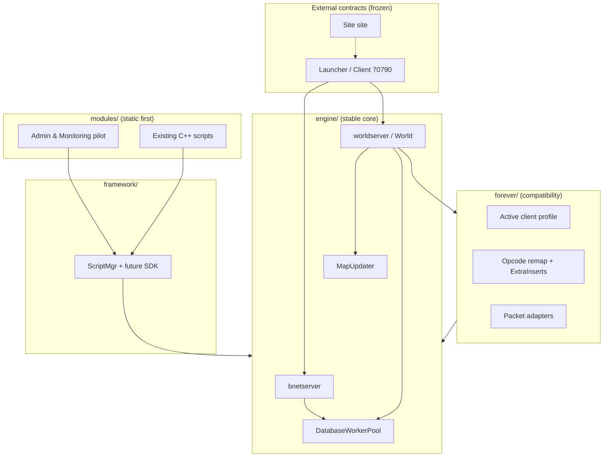

# Target Architecture (M1) — Incremental mapping onto the real tree

**Status:** Accepted (M2) (design only — no directory moves in M1)  
**Base tree:** TrinityCore Forever as in snapshot `113226264c` / `aeternum/main`  
**Italian:** [`../it/TARGET_ARCHITECTURE.md`](../it/TARGET_ARCHITECTURE.md)

## Guiding decisions (maintainer-approved)

1. **One active Forever client build at a time** (single client profile). Switching builds = replace/activate the next profile, not multi-profile runtime.
2. **Trinity Engine** (`<SERVER_ROOT>`) remains production until Aeternum is stable — dual maintenance.
3. **Priority #1:** client-update architecture + Module SDK; pilot module = **Administration & Monitoring**.
4. **Modern ≠ better:** no tech without proven benefit.
5. Map conceptual `engine/forever/framework/modules` onto the **existing** tree — do not force a big-bang restructure.

## Conceptual → real mapping

| Conceptual zone | Real anchors TODAY | What may move later (incremental) | What must NEVER move without ADR+migration |
|---|---|---|---|
| **engine/runtime** | `src/server/worldserver/Main.cpp`, `src/server/bnetserver/Main.cpp`, `src/server/game/World/World.cpp` | Optional thin wrappers / namespaces later | Process entry contracts (`worldserver`/`bnetserver` exe names) until launcher cutover ADR |
| **engine/networking** | `Server/WorldSocket*`, `WorldSession*`, `Protocol/Opcodes*`, `ClassicOpcodes*`, `Packets/` | Extract Forever wire adapters into `forever/client_profiles/` (logical first, physical later) | External ports **1119** / **8085** (launcher contract) |
| **engine/threading** | `Maps/MapUpdater.*`, `MapManager.*`, `common/Threading`, Asio in `common/Asio` | Measurement hooks only in M2–M3 | Map ownership invariant (one map tick not unsafely parallelized) |
| **engine/database** | `src/server/database/**`, `DatabaseWorkerPool`, `DBUpdater` | Migration tooling docs/CLI later | MySQL as system of record; DB names auth/characters/world/hotfixes |
| **engine/world & maps** | `Maps/`, `Grids/`, `Instances/`, `Entities/` | None initially | Core entity/map semantics |
| **engine/combat & spells** | `Combat/`, `Spells/` | None initially | Spell correctness |
| **forever/protocol** | `ClassicOpcodes.*`, conf `Classic.ClientExtraInserts` / `ServerExtraInserts` | **First isolation target:** profile manifest + inserts + opcode expectations | Ability to load exactly one active profile |
| **forever/client_profiles** | *Does not exist yet* (Planned) | New docs+data dir then code adapters in M4 | — |
| **forever/gameplay & data** | `sql/custom`, hotfixes DB, world Forever content | Keep SQL discipline; version profiles of data expectations | Rollback companions for fixes |
| **framework/hooks** | `Scripting/ScriptMgr.*` | Versioned SDK façade over ScriptMgr (M5) | Existing script registration must keep working |
| **framework/modules** | *Planned* — static modules first | Manifest + lifecycle around scripts | — |
| **modules/administration** | Chat GM commands today; Metric disabled | **Pilot:** Administration & Monitoring module (M5/M8 phased) | No arbitrary remote command execution |
| **runtimes/wasm** | Absent | Deferred — investigate only | — |
| **docs** | `docs/**` | Continuous EN+IT | Accuracy labels (Implemented/Proposed/Planned) |

## Layering diagram (target logical)

## What moves when (phase sketch — design intent)

| Phase | Allowed structural change |
|---|---|
| M1 | Docs/ADR only |
| M2 | Tooling/tests/docs quality — **no** tree reshuffle |
| M3 | Measurement hooks — minimal invasive |
| M4 | Introduce `forever/client_profiles/<build>/` **logical package** (may start as `forever/client_profiles/` to avoid deep moves); wire ExtraInserts+tests to profile |
| M5 | SDK headers + static module manifest for Admin pilot; scripts stay where they are |
| M6+ | Data/update manager; still prefer additive folders over mass renames |

## Explicit non-goals (M1–M3)

- Renaming `src/server/game` → `engine/`
- Multi-build concurrent profiles
- WASM/native hot-unload
- Replacing MySQL
- Touching Trinity Engine live tree from Aeternum automation
