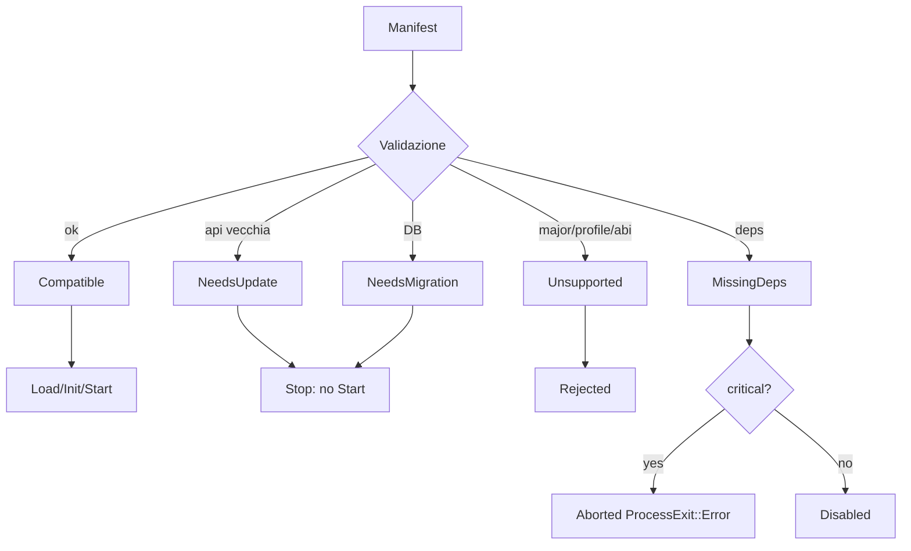

# Policy di compatibilità moduli

**Fase:** M0 — sola documentazione | **Data:** 2026-11-05 (Europe/Rome)  
**HEAD:** `a3bea2d1e2`  
**Allineato a:** D1 (`loadPolicy`/`on-boot-only`), D2 (`abiVersion` C boundary) **DECISIONE APPROVATA 2026-11-05**.

---

## 1. Obiettivo

Un aggiornamento Core non deve rompere moduli senza necessità. Un modulo incompatibile **non** si carica in silenzio.

---

## 2. Manifesto — schema completo (PROPOSTO; enforce M1+)

**Oggi (ESISTENTE parziale):** `ModuleDescriptor` C++ in `lifecycle.hpp`. **DECISIONE APPROVATA 2026-11-05 (D9):** da **M1** il file `module.manifest.json` è validato **al boot** (insieme a `loadPolicy`, default `on-boot-only`); assenza/invalidità → Rejected/Disabled secondo `critical`.

### 2.1 Esempio `module.manifest.json`

```json
{
  "id": "example.hello",
  "version": "1.2.0",
  "apiRange": ">=1.0.0 <2.0.0",
  "abiVersion": 1,
  "loadPolicy": "on-boot-only",
  "critical": false,
  "dependencies": {
    "required": [],
    "optional": ["ops.metrics"]
  },
  "incompatibleWith": [],
  "capabilities": ["log.write", "db.write.mod_own"],
  "supportedProfiles": ["1.60.1.70790"],
  "configSchema": "conf/example.hello.schema.json",
  "migrations": [
    { "from": "0", "to": "1.0.0", "up": "sql/mod_example_hello_0_to_1.sql", "down": "sql/mod_example_hello_1_to_0.sql" }
  ],
  "reload": null,
  "toolchain": {
    "cxx": "20",
    "crt": "MD",
    "abi": "c-boundary-1"
  },
  "integrity": {
    "sha256": "…"
  }
}
```

### 2.2 Campi obbligatori

| Campo | Tipo | Semantica | Default se assente |
|---|---|---|---|
| `id` | string | stabile, dotted | — (reject) |
| `version` | semver | versione modulo | — |
| `apiRange` | semver range | vs `kApiVersion*` lifecycle.hpp | — |
| `abiVersion` | uint | vs `AETERNUM_MODULE_ABI_VERSION` (D2) | `1` se Level 3; N/A static Level 1 |
| `loadPolicy` | enum | `on-boot-only` \| `runtime-restart` \| `hot-reloadable` | **`on-boot-only`** (**DECISIONE APPROVATA**) |
| `critical` | bool | fail → abort process | `false` |
| `dependencies.required` | string[] | id moduli | `[]` |
| `capabilities` | string[] | richieste al host | `[]` |
| `supportedProfiles` | string[] | Forever profiles; `[]` = tutti (comportamento attuale host) | `[]` |

### 2.3 Campi raccomandati

`configSchema`, `migrations[]`, `incompatibleWith`, `toolchain`, `integrity.sha256`, `reload` (solo se `hot-reloadable` + checklist DYNAMIC_LOADING).

**Regola D3:** se il modulo dichiara `hot-reloadable` ma le sue FT usano STL cross-boundary → **Rejected** in validazione.

---

## 3. Semver — API vs ABI

| Canale | MAJOR | MINOR | PATCH |
|---|---|---|---|
| **API** `aeternum/api` (`kApiVersionMajor/Minor/Patch`) | rimozione/cambio breaking header C++ frozen | aggiunta backward-compatible con consumer reale | fix senza cambio contratto |
| **ABI C** `abiVersion` | cambio layout FT / meaning handle / calling convention | aggiunta slot in coda FT con `struct_size` check | bugfix senza layout change |

**Cosa rompe ABI (non solo API):**
- Riordinare / rimuovere function pointer in `AeternumModuleFT` / `AeternumHostFT`
- Cambiare size/alignment di struct POD passate per valore
- Cambiare ownership stringhe (literal vs buffer)
- Cambiare `AETERNUM_MODULE_ABI_VERSION` senza bump

**Cosa rompe API ma non ABI C:**
- Aggiungere metodo a interfaccia C++ `IModule` usata solo in Level 1 static (comunque MAJOR se frozen public)
- Cambiare `Result<T>` template (Level 1)

---

## 4. Matching rules

| Check | Input | Pass | Fail state |
|---|---|---|---|
| apiRange | manifest vs host `1.0.0` | range contains | NeedsUpdate / Unsupported |
| abiVersion | manifest vs host constant | equal (Level 3) | Unsupported |
| loadPolicy | enum | known value; default on-boot-only | Rejected |
| deps required | ids present & Started | all found | MissingDeps |
| incompatibleWith | conflict set | empty intersection | Rejected |
| profile | active Forever profile | listed or list empty | Unsupported |
| capabilities | subset of host grant policy | all grantable | Denied→Rejected |
| toolchain/CRT | MD vs MD, C++20 | match | Unsupported (Level 3) |
| integrity | sha256 allowlist (**D10**) | match | Rejected |
| hot-reload+STL | FT inventory | no STL boundary | Rejected (D3) |

---

## 5. Cinque stati — decision table

| Stato | Significato | Azione host | Log | Critical? |
|---|---|---|---|---|
| **Compatible** | tutti i check OK | Load→Init→Start | info | — |
| **NeedsUpdate** | apiRange sotto host minor richiesto | **non** Start; messaggio versione | warn | se critical → Abort |
| **NeedsMigration** | schema DB dietro | **non** Start finché up-migration OK | warn | idem |
| **Unsupported** | major API/ABI o profile | Reject permanente in questa run | error | idem |
| **MissingDeps** | required assente/disabled | Disable (o Abort se critical) | error | `ModuleHost` già: critical abort (`ModuleHost.cpp:164-174`) |

Flusso (PROPOSTO, estende `PlanStaticModules` in `static_runtime.hpp`):



---

## 6. Deprecation timeline (PROPOSTO)

| Fase | Vincolo |
|---|---|
| Annuncio | log + doc in **minor** N |
| Grace | almeno **un** minor completo (N → N+1) con shim |
| Rimozione | solo in **MAJOR** successivo |
| Conf token plaintext admin | già WARN; fail-fast «later version» (`AdminTokenResolve.h:82-86`) — modello analogo |

---

## 7. Garanzie aggiornamento Core

| Garanzia | Livello |
|---|---|
| Moduli `apiRange` soddisfatto + `on-boot-only` ricompilati staticamente restano linkabili senza cambio source se solo PATCH/MINOR API | Obiettivo |
| Level 3 DLL senza recompile: solo se `abiVersion` invariato e FT append-only | Obiettivo Level 3 |
| Nessuna garanzia se modulo include header TC privati | Fuori contratto |
| IE-ADR-012: static through IE-M3 | **Invariato** |

---

## 8. Forever-only profiles

`supportedProfiles` include es. `1.60.1.70790`. Lista vuota = «tutti» (comportamento attuale planner). Moduli gameplay Classic devono listare esplicitamente.

---

## Registro revisioni

| Data | Modifica |
|---|---|
| 2026-11-05 | Pass 1 |
| 2026-11-05 | Block 2: schema JSON, abiVersion, on-boot-only, 5 stati, API vs ABI |
| 2026-11-05 | M1-Blocco1: manifest parser extracts id/abiVersion/loadPolicy/sha256-stub |
| 2026-11-05 | M1-Blocco2: D9 boot gate wired (`manifest_gate.hpp`, fail-closed; missing manifest = legacy unless `Aeternum.Modules.RequireManifest=1`) |
| 2026-11-05 | M1-Blocco4: real SHA-256 of integrity.file (D10); mismatch => Rejected |
