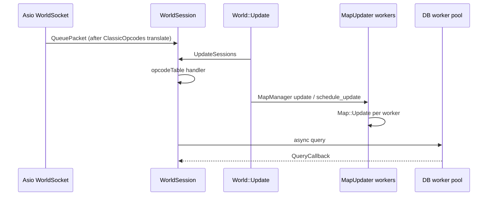

# AETERNUM_CURRENT_ARCHITECTURE

**Phase:** M0 deepened — domains 6.1–6.8  
**Date:** 2026-11-05 (Europe/Rome)  
**HEAD:** `9894b2e1c2`

## Threading model (CONFIRMED overview)

| Thread domain | Owner | Key types / functions | Notes |
|---|---|---|---|
| Main world loop | worldserver main thread | `while (!World::IsStopped()) sWorld->Update(diff)` in `Main.cpp` | Serial world orchestration |
| Map workers | `MapUpdater` | `activate` → `WorkerThread`; `schedule_update(Map&, diff)`; `wait()` | `CONFIG_NUMTHREADS`; metric `map_updater_queue_wait_ms` |
| Network (world) | Asio io_context threads | `WorldSocketMgr.StartNetwork`, `WorldSocket::ReadHandler` | Decrypt opcode → queue to session |
| Network (bnet) | bnet Asio + SSL | `Session`, `SslContext` | RPC + REST |
| DB workers | `DatabaseWorkerPool` | async queries / prepared stmts | Callbacks via `QueryCallbackProcessor` on session |
| Admin HTTP | dedicated thread in module | `AdminHttpServer` Beast | Must marshal mutations; defaults loopback |
| Metric flush | Metric subsystem timers | LocalStore flush | File I/O budgeted |

**Script comment in WorldSession.h (CONFIRMED):** Map::Update processes only thread-safe packets; unsafe/logout handled on world session update path.

---

## 6.1 Engine Core

### Lifecycle
- **Entry:** `src/server/worldserver/Main.cpp` — signals → `SignalHandler` → `World::StopNow`; Metric init with online_players/sessions/db_queue gauges; `sWorld->SetInitialWorldSettings()`; `sWorldSocketMgr.StartNetwork`; loop `sWorld->Update(diff)`.
- **World init:** `World::SetInitialWorldSettings` loads configs, DB version, managers; calls `Forever::ApplyActiveProfileDataAtStartup()` (line ~1284 World.cpp).
- **Shutdown:** KickAll, UpdateSessions, Metric Unload, socket mgr teardown; operator `STOP_SERVER.bat` 120s messaging (contrib).

### Configuration / logging / services
- `sConfigMgr` + Aeternum `ConfigSchema` (`src/common/Configuration/ConfigSchema.*`).
- Logging `common/Logging`; crash ring `CrashDumpBudget`.
- Global services: `sWorld`, `sMetric`, DB globals, `sWorldSocketMgr`, ScriptMgr singleton pattern.

### Trinity coupling
CRITICAL — core *is* Trinity worldserver. Aeternum adds Metric/profile/module hooks only.

---

## 6.2 Protocol Engine

### Socket path
- `WorldSocket::ReadHandler` — encrypted opcode peek; **`ClassicOpcodes::TranslateClientOpcode`** for Forever wire; auth path `HandleAuthSession`, `HandleEnterEncryptedModeAck`.
- Send path `SendPacket` / `EncryptablePacket` queue; compression threshold.

### Session dispatch
- `opcodeTable[OpcodeClient]` → `ClientOpcodeHandler` in `WorldSession` (see WorldSession.cpp ~67, 89, 392).
- Handlers live as `WorldSession::Handle_*` across `Handlers/*.cpp` (48 TUs).
- Nulls: `Handle_NULL`, `Handle_EarlyProccess` for early socket-processed packets.
- **Table size:** 1032 `DEFINE_HANDLER(CMSG_` in `Opcodes.cpp`; coverage report: 626 active / 380 UNHANDLED.

### Forever profile
- Types: `Forever::ClientProfileInfo`, `ProfileDriftReport`.
- Functions: `GetConfiguredActiveProfileId`, `TryLoadProfileExtraInserts`, `CheckProfileDataConsistency`, `ApplyActiveProfileDataAtStartup`, `EffectiveClientExtraInserts`.
- Remap: `Forever::OpcodeRemap::RemoveClientExtraInserts`, `WireToCoreAfterClientInserts` (header-only).
- `ClassicOpcodes.cpp` delegates ExtraInserts to Forever effective lists; `TranslateClientOpcode` / `TranslateServerOpcode` (+ 70245 layer).
- Data: `forever/client_profiles/ACTIVE` = `1.60.1.70790`; `extra_inserts.conf`; `manifest.json`.

### Packets
- 144 files under `Server/Packets` — Trinity structures; not profile-isolated yet.

### Extraction potential
Profile+remap = MEDIUM; full codec = HIGH. Strongest Aeternum-owned seam today.

---

## 6.3 World Engine

- **`World::Update(uint32 diff)`** — metric `world_update_time_total`; sequenced timers (who list, channels, resets, auctions, sessions, scripts-before-maps, **maps**, battlegrounds, outdoor PvP, …) with `TC_METRIC_TIMER("world_update_time", tag)`.
- **`MapManager`**: instance allocation; `m_updater.activate(CONFIG_NUMTHREADS)`; on update either direct `Map::Update` or `schedule_update` + `wait`.
- **`MapUpdater`**: `MapUpdateRequest` binds `Map&`; worker pops queue; `update_finished` decrements pending.
- Grids / visibility / movement: under `Maps/`, `Grids/`, `Movement/` — Trinity.
- **Boundary today:** none between API and impl — modules see `World.h` / `Map*`.

---

## 6.4 Gameplay Engine

- Combat `Combat/`, Spells `Spells/` (`Spell`, `SpellMgr`, auras), Quests, Items, AI `AI/`, Groups, Guilds, Instances, Battlegrounds, OutdoorPvP, Events.
- Ingress exclusively via Handlers after opcode remap.
- Script overlays via ScriptMgr (OnDamage, OnHeal, OnPlayer* ×48 hooks declared, etc.).
- Forever gameplay history also in SQL custom + Aeternum (pre-Aeternum commits).
- **Independent testing:** not feasible as a package; only narrow unit tests.

---

## 6.5 Data Engine

- **DB2:** `DB2Stores.cpp` `LoadDB2(...)` loads storages into `_stores`.
- **ObjectMgr:** **119** `ObjectMgr::Load*` functions — creatures, gameobjects, items, quests, vehicles, player info, shop, classic-specific loaders (`LoadCreatureClassicLevels`, `LoadItemClassicBlock`), etc.
- Hotfixes DB + `sql/custom/hotfixes` (22 files).
- Profile hotfix seams documented under `forever/client_profiles/.../seams/hotfix_seams.md` (docs, not a package validator product).

---

## 6.6 Persistence Engine

- `DatabaseEnv.h` exports four `DatabaseWorkerPool<>` globals.
- Prepared statement catalogs in `Implementation/{Login,Character,World,Hotfix}Database.h` (enum-ish CAPS line counts ~150 / ~600 / ~58 / ~846).
- Transactions: `Transaction.h`; async `QueryCallback`.
- Migrations: `DBUpdater` + `UpdateFetcher` over `sql/updates/<db>/master`.
- Custom content: large `sql/custom/world` (176).
- Gameplay includes `DatabaseEnv.h` directly (Handlers 21, Entities 13) — no repository ports.

---

## 6.7 Module Engine

- CMake `trinity_add_module` + generated `ModuleLoader.cpp` → `AddModuleScripts()`.
- SDK v0.2 draft: `IModule`, `ModuleDescriptor`, `LifecycleStage`, `RegisterModule`, `HostDiscoverAndStart` / `HostStopAndShutdown`.
- Planner: `aeternum::sdk::internal::PlanStaticModules` (cycles, deps, profile compatibility, critical abort).
- Host: `ModuleSdkWorldScript : WorldScript` in `ModuleHost.cpp` — includes `World.h`, `ScriptMgr.h`, `Forever/ClientProfile.h`.
- Consumer: `admin_monitoring` registers as module; still Trinity-coupled for HTTP readouts.
- **Dynamic/WASM:** deferred (`ModuleRuntime::Static` only).

---

## 6.8 Operations Engine

| Capability | Class / file | Default |
|---|---|---|
| Local metrics | `MetricLocalStore`, Aggregator, DailySummary, HumanReport, ErrorCollector | Off via Metric.Enable |
| Admin HTTP | `AdminHttpServer` Boost.Beast | `Admin.Enable=0`, bind `<redacted-ip>` |
| AuthZ | `AdminAuth` token (+ env), min length, operator token | tokens empty in dist |
| Rate limit | `AdminAuthRateLimit` | fail window |
| Audit | `AdminAuditLog` | file |
| Prometheus | `AdminPrometheus` dense | via admin |
| Drain flag | conf `Admin.Drain.Enable` | 0 |
| Config validate | `CHECK_CONFIG.bat`, ConfigSchema, `tools/config-validator` | — |
| Backup drill | docs only | — |

README claims these are “not shipped” — **stale** (CONFIRMED contradiction).

---

## bnetserver architecture (companion process)

- `Main.cpp` + SSL certs in tree (`bnetserver.cert.pem` / key — treat as sensitive ops material).
- `ServiceDispatcher` hash → protobuf services (see Dependency Analysis §5).
- `LoginRESTService` HTTP for forms + launcher endpoints.
- Shares auth DB with world via LoginDatabase patterns.

---

## What Aeternum added vs Trinity baseline

Anchored in `git diff b3c55465c8..HEAD`: Forever/, modules/sdk, admin_monitoring, Metric local*, ConfigSchema, CrashDumpBudget, contrib/aeternum, forever/client_profiles, tools/config-validator, tests gates, docs ADR-001..009 Accepted, banner.

## Uninspected in this document

- Full Handler-by-Handler semantics  
- AI brain internals  
- Exact Map grid algorithms  
- Every ScriptMgr hook call site  
- bnet numeric service hashes  

## Appendix A — World::Update phase map (CONFIRMED excerpts)

From `World.cpp` `World::Update` metric-tagged sections (non-exhaustive): Update who list; Save custom channels; Check daily reset; Reset random BG; Delete old calendar; Reset guild/currency caps; Update expired/pending auctions; Black market; AHBot; HotSwap; **Update sessions**; Uptime; Clean logs; **Update world scripts before maps**; **Update maps**; Terrain cleanup; Autobroadcast; Battlegrounds; Outdoor PvP; Battlefields; Delete old characters; …

Init side: timers `WUPDATE_AUCTIONS`, `WUPDATE_UPTIME`, `WUPDATE_CORPSES`, `WUPDATE_CLEANDB`, `WUPDATE_AUTOBROADCAST`, `WUPDATE_DELETECHARS`, `WUPDATE_AHBOT`, `WUPDATE_PINGDB`, `WUPDATE_GUILDSAVE`, `WUPDATE_BLACKMARKET`, `WUPDATE_CHECK_FILECHANGES`, `WUPDATE_WHO_LIST`, `WUPDATE_CHANNEL_SAVE`, `WUPDATE_EVENTS`.

## Appendix B — ScriptMgr surface (CONFIRMED sampling)

`ScriptMgr.h` declares multiple `*Script` base classes (≥13 class Script hits) and rich virtual hooks, including:

- Network: `OnSocketOpen/Close`, `OnPacketSend`, `OnPacketReceive` (takes `WorldSession*`, `WorldPacket&`) — **leaks Trinity types to all script authors**
- World: `OnConfigLoad`, `OnShutdownInitiate/Cancel`, `OnUpdate`, `OnBeforeMapsUpdate`, `OnWorldInitialized`, `OnStartup/Shutdown`
- XP/honor calculations
- Map: `OnCreate/Destroy`, `OnPlayerEnter/Leave`, `OnUpdate`
- Combat: `OnHeal`, `OnDamage`, `OnDamageSpell`
- ~48 `OnPlayer*` styled hooks (count via Select-String)

Aeternum Module SDK host currently **is** a `WorldScript`, so it inherits this coupling.

## Appendix C — ObjectMgr loader families

119 `Load*` functions include locales, creature templates (+ resistances, spells, models, addons, difficulty, sparring, classic levels), creatures/gameobjects spawns, spawn groups, items (+ classic block, shop), vehicles, pets, player info, quests (+ starters/enders/locales), and more. This is the **content spine**; any Data Engine port must façade these gradually.

## Appendix D — Admin monitoring endpoints (from code structure)

`AdminHttpServer.cpp` (~631 lines) serves read-oriented routes behind token auth; Prometheus densification in `AdminPrometheus.h`; audit trail `AdminAuditLog`. Conf keys: Enable, BindIP, Token/TokenFromEnv, TokenMinLength, AuthFail*, OperatorToken*, Drain.Enable. **Security posture:** fail-closed defaults — CONFIRMED in `.conf.dist`.

## Appendix E — Metric sink pipeline

`Metric` → optional local sink path: sample → `MetricAggregator` windows (10s/1m/1h/1d) → `MetricLocalStore` files with BudgetMB/Retention/MaxSeries → `MetricHumanReport` + `MetricDailySummary` + `MetricErrorCollector`. ~1804 lines in Metric/ directory. Instrumented heavily in World::Update and MapManager wait.

---

## Verified opcode recount note (2026-11-05)

Independent recount (+ QA agree): `DEFINE_HANDLER(CMSG_)` **1032**, `STATUS_UNHANDLED` **380**, active-wired **626** (628 active-status − 2 Handle_NULL). Evidence JSON at ``<buildlogs>`` exists but contains stale 1031/379 — **do not prefer JSON over recount**. Unknown wire `0x3D013D` = **PARTIALLY CONFIRMED**. Catch2 current green = **NOT VERIFIED** this phase; last green log ``<archive>`` (1841 assertions / 110 cases).
