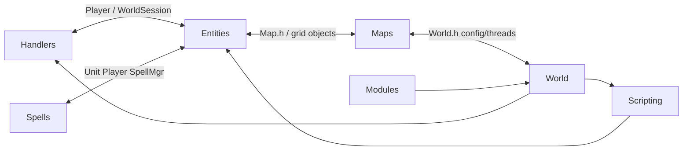
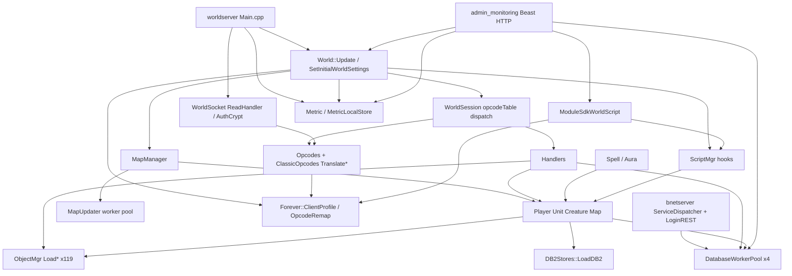

# AETERNUM_DEPENDENCY_ANALYSIS

**Phase:** M0 Independent Engine — deepened pass  
**Date:** 2026-11-05 (Europe/Rome)  
**HEAD:** `9894b2e1c2` `aeternum/main`  
**Method:** read-only `#include` sampling; top-include frequency; class/function anchors.  
**Labels:** CONFIRMED / PARTIALLY CONFIRMED / INFERRED / UNKNOWN  
**Companion raw dump:** `_include_sample.txt`

## 1. Include-graph sample

| Directory | Files | `#include` count | Dominant classified buckets |
|---|---:|---:|---|
| `src/common` | 209 | 974 | Common 157, ThirdParty 78, Maps 11 (leak) |
| `src/server/database` | 48 | 261 | Database 91, Common 32 |
| `game/Entities` | 125 | 1183 | Entities 95, Maps 65, Spells 62, DataStores 38, ServerProtocol 30, Database 21, World 16 |
| `game/Maps` | 25 | 234 | Maps 37, Common 17, DataStores 7, Entities 5, Database 5, World 4 |
| `game/Spells` | 21 | 354 | Spells 52, Entities 26, Maps 15, DataStores 11 |
| `game/Handlers` | 49 | 720 | Entities 84, ServerProtocol 52, Spells 32, DataStores 28, Database 21, World 19, Scripting 8 |
| `game/Server` | 159 | 715 | ServerProtocol 186, Entities 16, DataStores 15, Forever 2 |
| `game/World` | 5 | 125 | Maps 7, Database 4, Forever 1, Scripting 2 |
| `game/Scripting` | 9 | 97 | Entities 5, Spells 3, Maps 3 |
| `game/DataStores` | 13 | 79 | DataStores 13, Common 9 |
| `game/Forever` | 3 | 17 | Common 4 — **lowest coupling in game/** |
| `src/modules` | 15 | 93 | ModuleSDK 8, Scripting 3, World 2, Common 7 |

**Classifier limit (CONFIRMED):** large `Other` bucket = bare includes not matched by filename heuristics. Compensated by top-include lists below.

### 1.1 Gravity wells (top `#include "..."` frequencies)

| Subsystem | Top includes (count) |
|---|---|
| Entities | Player.h 37, DB2Stores.h 28, ObjectMgr.h 24, SpellMgr.h 16, World.h 16, Map.h 16, WorldSession.h 14, DatabaseEnv.h 13 |
| Handlers | WorldSession.h 48, Player.h 43, ObjectAccessor.h 27, DB2Stores.h 25, ObjectMgr.h 25, DatabaseEnv.h 21, World.h 19, ScriptMgr.h 8 |
| Spells | SpellMgr/Spell.h 8, Player.h 7, DB2Stores.h 7, ScriptMgr.h 5, Unit.h 4 |
| Maps | Map.h 7, DB2Stores.h 6, World.h 4, DatabaseEnv.h 4, Metric.h 3, MapUpdater.h 2 |
| Server | PacketOperators.h 69, Packet.h 61, ObjectGuid.h 48, Player.h 9, Opcodes.h 4 |
| Modules | registry.hpp / module.hpp, ScriptMgr.h 3, World.h 2, DatabaseEnv.h 1, Metric*.h, Forever/ClientProfile.h |
| World | ObjectMgr.h, MapManager/Map, ScriptMgr, DatabaseEnv, Metric, Forever (ApplyActiveProfile), WorldSession |

### 1.2 Cycles (CONFIRMED)

Evidence: Entities includes `WorldSession.h` (14); Maps includes `World.h` (4); World includes `Player.h` and `MapManager.h`; Handlers always include `WorldSession.h`+`Player.h`.

## 2. System dependency diagram

## 3. Component matrix (7 questions each)

### 3.1 Engine core — `World` / `worldserver/Main`

| Question | Answer | Evidence |
|---|---|---|
| Depends on | MapManager, sessions, ScriptMgr, DB pools, Forever profile, Metric, Config | `World.cpp` includes Metric; `ApplyActiveProfileDataAtStartup`; `Main.cpp` Metric + `SetInitialWorldSettings` + `World::Update` loop |
| Depended by | Main, Module host, Admin (World.h), Maps (World.h) | module/admin includes |
| Exposes | Global `sWorld`, tick, configs, shutdown flags | `World::IsStopped`, `StopNow` |
| Consumes | Almost every game subsystem | Update timers WUPDATE_* |
| Independently testable? | **No** | Requires full boot |
| Extractable? | Kernel façade only (MEDIUM); body CRITICAL | IE-M1/M8 |
| Breaks if replaced | Entire process | CRITICAL coupling |

### 3.2 Protocol — WorldSocket / WorldSession / Opcodes / Forever

| Question | Answer | Evidence |
|---|---|---|
| Depends on | AuthCrypt, ClassicOpcodes, Packets, Player (session), Forever ExtraInserts | `WorldSocket.cpp` TranslateClientOpcode; `ClassicOpcodes.cpp` → `Forever::EffectiveClientExtraInserts` |
| Depended by | World update sessions; Handlers | `WorldSession::Update` / opcodeTable |
| Exposes | Opcode table (~1032 DEFINE_HANDLER CMSG), packet structs (144 files) | `Opcodes.cpp`, `Server/Packets` |
| Consumes | Profile inserts, build auth (socket path) | Client test 2026-11-05 |
| Testable? | **Partial** — Remap pure + Catch2 gates; full session **No** | `ClassicOpcodeRemap.h`, tests/game/* |
| Extractable? | Profile+remap MEDIUM; full codec HIGH | IE-M2 |
| Breaks if replaced | Login / char create / all gameplay ingress | HIGH–CRITICAL |

### 3.3 World simulation — Maps / MapUpdater

| Question | Answer | Evidence |
|---|---|---|
| Depends on | Map, entities, World config CONFIG_NUMTHREADS, Metric | `MapManager.cpp` `m_updater.activate`; `schedule_update`; `TC_METRIC_TIMER("map_updater_queue_wait_ms")` |
| Depended by | World::Update maps section | World.cpp Update maps |
| Exposes | Per-map tick; instance ids | MapUpdater::{activate,schedule_update,wait,WorkerThread} |
| Consumes | Entity grid state | Map update request holds `Map&` |
| Testable? | No (threading+maps) | — |
| Extractable? | CRITICAL | IE-M4 |
| Breaks if replaced | All visibility/combat/movement | CRITICAL |

Threading model (CONFIRMED): `MapUpdater::activate(num_threads)` spawns `std::thread` workers; `ProducerConsumerQueue<MapUpdateRequest*>`; `wait()` blocks until `pending_requests==0`. **Invariant:** one map's update not parallelized with itself (request per map). Network Asio threads distinct; DB worker threads distinct; Admin HTTP uses its own thread (must not mutate maps directly).

### 3.4 Gameplay — Spells / Handlers / AI / …

| Question | Answer | Evidence |
|---|---|---|
| Depends on | Entities, DB2, ObjectMgr, ScriptMgr, DatabaseEnv | Spells/Handlers include tables above |
| Depended by | WorldSession dispatch | Handlers methods on WorldSession |
| Exposes | Rule implementations | Spell.cpp, 48 handler TUs |
| Consumes | Templates + runtime entities | ObjectMgr + Player |
| Testable? | Narrow Catch2 only | tests/game/* spell-ish |
| Extractable? | CRITICAL without ports | IE-M4/M9 |
| Breaks if replaced | Combat/quests/items | CRITICAL |

### 3.5 Data — DB2Stores / ObjectMgr

| Question | Answer | Evidence |
|---|---|---|
| Depends on | DB2 files path, Database for templates | `LoadDB2` in DB2Stores.cpp; ObjectMgr::Load* uses Field* |
| Depended by | Entities, Handlers, Spells, World init | include frequencies |
| Exposes | 119 `ObjectMgr::Load*` functions; DB2 storage map | ObjectMgr.cpp |
| Consumes | SQL world/hotfixes + DB2 | DBUpdater separately |
| Testable? | Partial load tests absent in-tree | UNKNOWN coverage |
| Extractable? | HIGH | IE-M5 |
| Breaks if replaced | Spawns, items, quests | HIGH |

### 3.6 Persistence — DatabaseWorkerPool / statements / DBUpdater

| Question | Answer | Evidence |
|---|---|---|
| Depends on | MySQL C API, conf connection (not inspected) | MySQLConnection.cpp |
| Depended by | bnet + world + almost all game | DatabaseEnv.h globals |
| Exposes | `LoginDatabase`, `CharacterDatabase`, `WorldDatabase`, `HotfixDatabase` | DatabaseEnv.h |
| Consumes | Prepared statement enums (~CAPS lines: Char~600, Login~150, World~58, Hotfix~846) | Implementation/*.h |
| Testable? | Limited | — |
| Extractable? | HIGH–CRITICAL | IE-M5 |
| Breaks if replaced | Auth, saves, world load | CRITICAL |

DBUpdater (CONFIRMED): applies `sql/updates/<db>/master/*.sql` via UpdateFetcher; source dir from BuiltInConfig. Live apply state: see §4.

### 3.7 Module engine — SDK + admin_monitoring

| Question | Answer | Evidence |
|---|---|---|
| Depends on | ScriptMgr WorldScript, Forever profile id, World.h, DatabaseEnv (admin), Metric | ModuleHost.cpp; AdminHttpServer.cpp includes |
| Depended by | generated ModuleLoader → worldserver | modules CMake |
| Exposes | IModule lifecycle; HTTP /metrics (admin) | module.hpp; AdminHttpServer |
| Consumes | Host registration; Trinity read APIs | — |
| Testable? | Planner yes; HTTP partial unit | tests/modules/* |
| Extractable? | MEDIUM (headers first) | IE-M3 |
| Breaks if replaced | Ops visibility; future modules | MEDIUM |

### 3.8 Operations — Metric local sink

| Question | Answer | Evidence |
|---|---|---|
| Depends on | Metric core, filesystem, Config | MetricLocalStore.* ~1804 LOC Metric/ |
| Depended by | Main, World timers, MapManager, Admin Prometheus | includes |
| Exposes | .mlines, daily summary, human report, ~75MB budget | docs + code |
| Consumes | TC_METRIC_* instrumentation | World::Update |
| Testable? | **Yes** | tests/common/MetricLocal.cpp |
| Extractable? | MEDIUM | IE-M1/M7 |
| Breaks if replaced | Observability only | LOW–MEDIUM |

### 3.9 bnet / LoginREST

| Question | Answer | Evidence |
|---|---|---|
| Depends on | proto stubs, auth DB, SslContext | bnetserver/Services, REST |
| Depended by | Forever launcher / client | external |
| Exposes | RPC services (§ below) + HTTP login forms | ServiceDispatcher |
| Consumes | auth schema | — |
| Testable? | Manual / few automations | UNKNOWN CI |
| Extractable? | HIGH (separate process already) | adapter later |
| Breaks if replaced | All login | CRITICAL |

## 4. sql/updates vs live schema

**On-disk (CONFIRMED):**

| Tree | SQL files |
|---|---:|
| `sql/updates/auth/master` | 5 |
| `sql/updates/characters/master` | 3 |
| `sql/updates/world/master` | 33 |
| `sql/updates/hotfixes/master` | 1 |
| **updates total** | **42** |
| `sql/custom/auth` | 26 |
| `sql/custom/characters` | 11 |
| `sql/custom/world` | 176 |
| `sql/custom/hotfixes` | 22 |

[redacted-sensitive-line]

**PARTIALLY CONFIRMED via Server.log** (``<aeternum-root>`\build\bin\RelWithDebInfo\logs\Server.log`, soak instance):

- Auth: up-to-date — Containing **31 new** and **537 archived** updates  
- Character: up-to-date — **14 new**, **203 archived**  
- World: up-to-date — **209 new**, **9480 archived**  
- Hotfixes: up-to-date — **23 new**, **988 archived**  
- Forever ExtraInserts auto-applied from profile `1.60.1.70790`

Interpretation: DBUpdater believes applied set matches source fetcher view for that datadir. Exact equality of every `sql/custom` file to rows is **UNKNOWN** without SELECT.

## 5. bnet protobuf RPC map (high level)

`Battlenet::ServiceDispatcher` registers (CONFIRMED `ServiceDispatcher.cpp`):

| Service registration | Role (high level) |
|---|---|
| `Services::V1::Account` / `V2::Account` | Account + game account state/info/restrictions |
| `Services::V1::Authentication` / `V2::Authentication` | Logon, VerifyWebCredentials / VerifyAuthToken, Generate* |
| `Services::V1::Connection` | Connect, KeepAlive, RequestDisconnect |
| `Services::V1::GameUtilities` / `V2::GameUtilities` | ProcessClientRequest / ProcessTask, GetAllValuesForAttribute (realmlist etc.) |
| `Services::V1::Resources` | GetTitleIcons |
| Protobuf `friends` v1 + v2 client | Friends social |
| `notification` v1 + v2 | Notifications |
| `presence` v1 + v2 | Presence |
| `report` v1 + v2 + v3 | Reporting |
| `block_list` v1 | Block list |
| `club` + `club_membership` v1 | Clubs |
| `whisper` v2 | Whisper |

Dispatch: `Dispatch(Session*, serviceHash, token, methodId, MessageBuffer)` → hash map of handlers.

**LoginREST** (parallel HTTP, CONFIRMED): `HandleGetForm`, `HandleGetGameAccounts`, `HandleGetPortal`, `HandlePostLogin`, `HandlePostLoginSrpChallenge`, authenticator, refresh ticket, **launcher** remember/login/forget endpoints.

## 6. Coupling summary

| Level | Subsystems |
|---|---|
| LOW | Forever profile files, ClassicOpcodeRemap.h, config-validator, contrib bats, Metric store math |
| MEDIUM | ClientProfile.cpp, Metric hooks, ConfigSchema, CrashDumpBudget, admin_monitoring, SDK host |
| HIGH | Opcodes/session/packets, ScriptMgr, ObjectMgr/DB2, Database statements usage |
| CRITICAL | Player/Unit/Creature/Map/World, MapUpdater, end-to-end login→combat |

## 7. Still incomplete within dependency analysis

- Full clang `-H` / iwyu graph per TU  
- Exact edge weights for `Other` bucket reclassification  
- scripts/ tree include graph  
- bnet methodId numeric hash table dump  
- Row-level `updates` SQL vs filesystem diff  

## 8. Database statement surface (evidence)

| Header | Approx CAPS enumerator lines | Role |
|---|---:|---|
| LoginDatabase.h | ~150 | Auth/bnet/account |
| CharacterDatabase.h | ~600 | Characters/inventory/... |
| WorldDatabase.h | ~58 | World content queries (many via ad-hoc/raw too) |
| HotfixDatabase.h | ~846 | Hotfix rows |

Gameplay/Handlers depend on these symbols directly → persistence extraction cannot be a rename; it needs call-site ports.

## 9. Packet / opcode quantitative coupling

- `Opcodes.cpp`: 1032 `DEFINE_HANDLER(CMSG_`
- Coverage report: 626 active, 380 UNHANDLED, 16 IGNORED, 8 NEVER
- `ClassicClientOpcodes.inc`: 686 remap entries; 0 missing handler names
- Packets directory: 144 files — each typically includes Packet.h / ObjectGuid / domain types; several include Player.h

## 10. Module ↔ Trinity include edges (exact)

From modules tree top includes:

- `ScriptMgr.h` ×3 (host + admin scripts)
- `World.h` ×2
- `DatabaseEnv.h` ×1 (admin)
- `Metric.h` / `MetricLocalStore.h`
- `Forever/ClientProfile.h` ×1 (host)
- `aeternum/sdk/*` public

**Conclusion (CONFIRMED):** public SDK headers themselves avoid Trinity types; **host and first consumer do not**. IE-M3 must split “public SDK” from “host adapter”.

---

## Verified opcode recount note (2026-11-05)

Independent recount (+ QA agree): `DEFINE_HANDLER(CMSG_)` **1032**, `STATUS_UNHANDLED` **380**, active-wired **626** (628 active-status − 2 Handle_NULL). Evidence JSON at ``<buildlogs>`` exists but contains stale 1031/379 — **do not prefer JSON over recount**. Unknown wire `0x3D013D` = **PARTIALLY CONFIRMED**. Catch2 current green = **NOT VERIFIED** this phase; last green log ``<archive>`` (1841 assertions / 110 cases).
