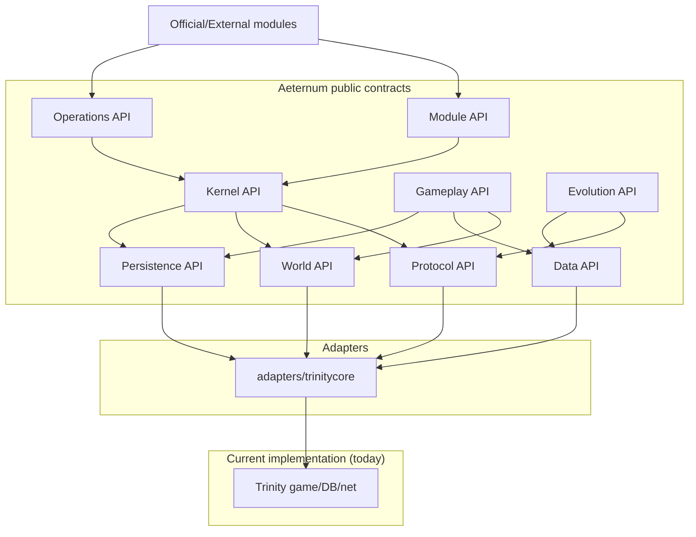

# AETERNUM_INDEPENDENT_ENGINE_ARCHITECTURE

**Status:** Proposed (M0 Independent Engine track) — **not approved for implementation**  
**Date:** 2026-11-05 (Europe/Rome)  
**Relation to existing docs:** Extends/supersedes *conceptual direction* of `docs/architecture/en/TARGET_ARCHITECTURE.md` for the Independent Engine goal. Does **not** delete Accepted operational ADR-001..009; see IE-ADR mapping.

## 1. Goals and non-goals

**Goals:** Forever-only compatibility; progressive independence from Trinity *types* in public APIs; modular monolith; preserve working gameplay and existing Aeternum work; testability; long-term evolution.

**Non-goals:** Multi-expansion support; microservices; big-bang directory rename; claiming GPL freedom via adapters alone; sacrificing login/combat stability for purity.

## 2. Architectural style: Modular Monolith

One deployable world stack (`bnetserver` + `worldserver` initially), internally partitioned into domains with **enforced dependency rules**. TrinityCore code moves behind `adapters/trinitycore` over milestones — physically late, contractually early.

## 3. Nine domains

### 3.1 Engine Kernel
- **Responsibilities:** process lifecycle, service registry, config bootstrap, logging façade, shutdown/drain orchestration, time source.  
- **Public interfaces:** `IEngineHost`, `IServiceRegistry`, config snapshot (POD).  
- **Forbidden deps:** Player/Map/WorldSession headers.  
- **Threads:** owns process main loop coordination; does not run map logic.  
- **Data ownership:** process-level config; no game entities.  
- **Trinity relation:** initially wraps `Main.cpp` / `World::StopNow` / signal handlers.  
- **Extraction:** IE-M1 sketches → IE-M1/M8 hardening.

### 3.2 Protocol Engine
- **Responsibilities:** client profile, opcode registry, ExtraInserts remap, packet codec boundaries, session *protocol* state (not gameplay).  
- **Public interfaces:** `IClientProfile`, `IOpcodeMap`, `IPacketCodec` (bytes in/out), build identity.  
- **Forbidden deps:** gameplay systems; entity types.  
- **Threads:** network threads call codec; must be thread-safe or explicitly confined.  
- **Trinity relation:** ClassicOpcodes/WorldSocket remain adapter.  
- **Extraction:** **first high-leverage domain** (builds on existing Forever work).

### 3.3 World Engine
- **Responsibilities:** maps, spatial index, entity *handles*, visibility queries, instance lifecycle, tick scheduling ports.  
- **Public interfaces:** `EntityId`, `MapId`, `IWorldView`, `ISpatialQuery` — **handles/IDs, not Player***.  
- **Forbidden deps:** module → Trinity entity headers; protocol codecs.  
- **Threads:** preserve one-map tick ownership invariant (Accepted ADR-005 spirit).  
- **Extraction:** late (IE-M4); adapters wrap Map/MapUpdater.

### 3.4 Gameplay Engine
- **Responsibilities:** rules for combat, spells, quests, items, AI decisions *as services*.  
- **Public interfaces:** command/query services with POD results; event subscriptions via Module API.  
- **Forbidden deps:** sockets; SQL types in public headers.  
- **Extraction:** IE-M4+; only after World handles exist.

### 3.5 Data Engine
- **Responsibilities:** client data / DB2-like catalogs, template stores, content package manifests, validation.  
- **Public interfaces:** immutable data views; versioned content IDs.  
- **Extraction:** IE-M5; start with profile+hotfix seam docs already present.

### 3.6 Persistence Engine
- **Responsibilities:** repositories, transactions, migrations ports.  
- **Public interfaces:** `ICharacterRepository`, unit-of-work; **no** `PreparedStatement` in public SDK.  
- **Forbidden deps:** network.  
- **Trinity relation:** DatabaseWorkerPool behind adapter.  
- **Extraction:** IE-M5; high risk — go slow.

### 3.7 Module Engine
- **Responsibilities:** discover/load/init/start/stop; dependency plan; profile compatibility; version negotiate.  
- **Public interfaces:** evolve current `aeternum::sdk` toward **non-draft** without Trinity types.  
- **Host services:** log/metrics/clock via opaque `HostServices` (already sketched).  
- **Extraction:** IE-M3 after Kernel contracts; keep static-only until IE-ADR-012 decides otherwise.

### 3.8 Operations Engine
- **Responsibilities:** admin HTTP, metrics export, health, audit, config validate, backup drills hooks.  
- **Public interfaces:** read models (POD snapshots); explicit operator commands with authz.  
- **Forbidden deps:** mutating World via raw pointers from HTTP thread without marshaling.  
- **Extraction:** IE-M1/M2 tighten admin off Trinity headers using snapshots.

### 3.9 Evolution Engine
- **Responsibilities:** compatibility lab, profile diffing, opcode coverage tooling, upgrade checklists, module compatibility matrix.  
- **Mostly tools/** initially — not in hot path.  
- **Extraction:** IE-M6+.

## 4. Target repository structure (future — do not move now)

Conceptual target (from brief). **Migration rule:** invert dependencies first; move files only when a domain compiles against contracts without including Trinity public types.

**Remain in place initially:** `src/server/game/**` gameplay, `src/server/database/**`, `dep/**`, `sql/**`.

**Additive soon (after approval):** `engine/contracts/` (headers), `profiles/forever/` (may alias `forever/client_profiles`), `adapters/trinitycore/` (shim TUs), `tools/*-lab/`.

**Introduce later:** physical `domains/*` splits.

**Never move without ADR+launcher plan:** executable names/ports contracts until cutover approval.

## 5. Trinity as adapter (critical rule)

New public Aeternum APIs **must not** expose: `Player*`, `WorldSession*`, `Map*`, `Unit*`, `Creature*`, `WorldObject*`.

Adapters translate:

`EntityId` ↔ `ObjectGuid` / `Player*` (internal only).

## 6. Preservation of Aeternum work

Profiles, Metric local sink, admin_monitoring, SDK draft, config-validator, contrib bats, Catch2 gates, Accepted ADR-001..009 operational decisions (dual maintenance, Forever single profile, threading caution) remain in force unless owner supersedes via IE-ADR acceptance.

## 7. Phase J — QA architectural validation (10 scenarios)

| # | Scenario | Current feasibility | Required changes | Missing interfaces | Required tests | Main risks |
|---|---|---|---|---|---|---|
| 1 | New client profile without gameplay edits | **PARTIALLY YES** (ExtraInserts/profile path exists; packet struct changes may still touch Packets/*) | Stronger packet adapter layer | `IPacketCodec` per message | Profile golden tests | Hidden struct drift |
| 2 | Packet serialization tested alone | **PARTIAL** (remap unit tests only) | Codec extracted from WorldSession | Codec API | Golden vectors | False green |
| 3 | Module without Trinity headers | **NO** | HostServices + read models | Trinity-free SDK | SDK compile test w/o game includes | Feature starvation |
| 4 | World entities without legacy class leak | **NO** | Handle-based World API | `EntityId`/`IWorldView` | ABI/handle lifetime tests | Dangling handles |
| 5 | Gameplay services without full server | **NO** (only narrow unit tests) | Service ports + fakes | Gameplay interfaces | Component tests | Behavioral drift |
| 6 | Swap DB impl without gameplay rewrite | **NO** | Persistence repositories | `I*Repository` | Contract tests vs MySQL | Perf/TX bugs |
| 7 | Content packages validated independently | **PARTIAL** (ExtraInserts validator + drift) | Content manifest validator | Data package API | CI validator | False trust |
| 8 | Replace one subsystem safely | **NO** generally | Adapters + feature flags | Per-domain ports | Soak + regression | Instability |
| 9 | Detect incompatible modules | **PARTIAL** (sdkRange string + planner profile check; not enforced semver) | Version negotiate on load | SDK version policy | Negative tests | Silent break |
| 10 | Legacy + new impl coexist | **INFERRED possible** via adapters behind flags | Dual impl routing | Kernel feature flags | A/B soak | Dual maintenance cost |

### Unnecessary complexity warnings (QA)

- Avoid full ECS rewrite.  
- Avoid microservices.  
- Avoid ABI-stable C API until module dynamic loading is actually approved.  
- Avoid renaming `src/server/game` early.

## 8. GPL note (not legal advice)

Adapter wrapping GPL TrinityCore in the same process generally keeps the combined work under GPL obligations. Architectural independence ≠ license independence. Owner decision #1 required.

---

## Verified opcode recount note (2026-11-05)

Independent recount (+ QA agree): `DEFINE_HANDLER(CMSG_)` **1032**, `STATUS_UNHANDLED` **380**, active-wired **626** (628 active-status − 2 Handle_NULL). Evidence JSON at ``<buildlogs>`` exists but contains stale 1031/379 — **do not prefer JSON over recount**. Unknown wire `0x3D013D` = **PARTIALLY CONFIRMED**. Catch2 current green = **NOT VERIFIED** this phase; last green log ``<archive>`` (1841 assertions / 110 cases).

## Phase J (expanded) — measurable criteria

See also `AETERNUM_RISK_REGISTER.md` Phase J table (PASS/FAIL/fixtures). Summary for architecture consumers:

**Near-term independence bar (not “done engine”):** PASS scenarios 1, 3, 9 + README honesty + verified opcode baseline documented + Catch2 re-run when authorized.

**Current scores (M0):**  
1 PARTIAL / 2 PARTIAL / 3 FAIL / 4 FAIL / 5 FAIL / 6 FAIL / 7 PARTIAL / 8 FAIL / 9 PARTIAL / 10 INFERRED.  
⇒ Target architecture is justified; **implementation independence is not achieved**.

## Repository migration path (detail)

| Stage | Structural change allowed | Dependency rule |
|---|---|---|
| IE-M1 | Additive contracts/docs only | No new includes of forbidden types into public contracts |
| IE-M2 | Optional `adapters/trinitycore/protocol` shim TUs | Gameplay must not gain new build ifdefs |
| IE-M3 | SDK include tree purified; host stays under adapters or modules/sdk/src | Modules compile against sdk+contracts only |
| IE-M4+ | Introduce `domains/` only after ports compile | Physical move last |
| IE-M9 | Shrink adapter body | Measure include edges quarterly |

## GPL reminder
Architectural independence can proceed under GPL-2.0. Claiming a non-GPL independent product requires owner decision #1 and likely clean-room work — **out of scope for adapters alone**.
